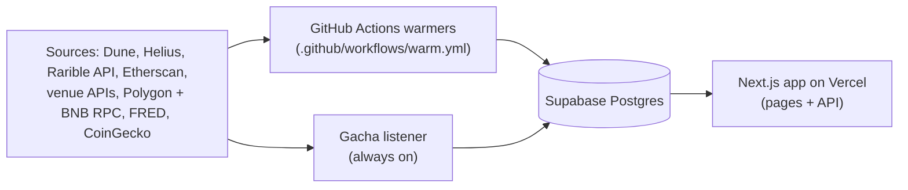

# Varible handover

Written Oct 26 2026 against `main` at `cc4bb06`. It explains how to run, check and repair the site. For local setup and a map of the repo, see the [README](../README.md).

## In short

- **The site runs itself.** GitHub Actions refreshes the data every 6 hours, every day and every Monday. Pages read only Postgres.
- **Health shows in two places.** [/status](https://varible.rarible.com/status) lists every feed's last run. A red run in the Actions tab means a required feed failed or went stale.
- **Three things need a new owner:**
  1. **The gacha listener** runs on the previous project lead's Mac and stops when that machine does. It needs a host ([details](#the-gacha-listener)).
  2. **The schedules switch off after 60 days without repository activity.** GitHub does this in public repositories ([details](#costs-and-limits)).
  3. **Two keys are being re-issued** during the handover: `FRED_API_KEY` and `ETHERSCAN_API_KEY` ([details](#secrets-and-environment)).

## Architecture



- **Pages never call a source while they render.** They read rows the warmers wrote. The one exception is the vault pages, which call Helius on request; they are off in production (`/vault` returns 404; the switch is `NEXT_PUBLIC_VAULT_ENABLED`).
- **Postgres holds four kinds of data.**

  | Kind | Tables | What it holds |
  |---|---|---|
  | Snapshots | `snapshots` | One JSON blob per key: the homepage payload, gacha, holders, the price index and others. |
  | The spine | `metric_snapshots` | Daily values per entity (platform or IP) and metric, for example `volume_usd`, `gacha_volume_usd`, `mcap_usd`. |
  | Freshness | `source_freshness` | One row per feed: last run, status and rows written. It drives /status and the gates. |
  | Row stores | `cards`, `listings`, `secondary_sales`, `gacha_pulls`, `renaiss_sales`, `renaiss_pulls`, `dyli_sales`, `report_subscribers` | Raw rows. `report_subscribers` holds subscribers' email addresses, so treat it as personal data. |

- **Caching delays fresh writes.** Most pages revalidate every 30 minutes; `/gacha`, `/report` and `/methodology` every 60. Server data caches hold for 10 to 60 minutes. The chart and v1 API responses carry `s-maxage=1800, stale-while-revalidate=3600`. A snapshot write can take an hour or more to reach every page.

## Venues and their sources

| Venue | Chain | Where the figures come from | What breaks |
|---|---|---|---|
| Collector Crypt | Solana | Resale: Dune query 7675297, cleaned of wash trades (`secondaryHygiene`). Packs: Dune gacha queries, plus Collector Crypt's own gacha API and the listener. Buybacks: Dune query 8252735. Market cap: the "Insured Value" trait from the weekly trait crawl (Helius DAS). Holders: Helius DAS. | A fresh Dune run that can't finish within 8 minutes. The core warmer then uses Dune's latest stored result. |
| Courtyard | Polygon | Resale: Rarible's activity index (OpenSea trades) plus Courtyard's own exchange, read from Polygon over a public RPC. Buyback-arbitrage trades are kept out of resale. Buybacks: exchange trades bid by Courtyard's operations wallet. Packs: one aggregate row in the Dune gacha queries. Listings: Rarible sell orders. | Rarible slowness: listings stop at an 8-minute budget per venue. Market cap is not computed because there are no Courtyard rows in `cards`. Holders are not read. |
| Beezie | Base | Resale: Beezie's own `api.beezie.com/activity`. Listings and market cap: Rarible sell orders, priced at each card's cheapest ask. Holders: Rarible ownerships. Claw catalog: `api.beezie.com/claw` (Beezie's stated values). | **Resale:** `/activity` sometimes answers with a Cloudflare challenge (403). The site then shows "resale not read since …" (`src/lib/data/resaleFeedState.ts`). **Packs:** marked closed since Oct 19 2026, because the Claw contract on Base stopped taking USDC (`CLOSED_PACK_FEEDS` in `src/lib/data/packFeedState.ts`). Remove that entry once the new contract is traced. |
| Phygitals | Solana (compressed NFTs) | Packs: Dune gacha queries, plus Phygitals' CLAW feed and the listener. Holders: Helius DAS over its two collections. Resale is not read: its `/sales` feed is packs only, and its trades on Tensor and Magic Eden are not ingested. | **Listings:** the public route has returned 404 since Oct 18 2026, so the floor × supply market cap is withheld with a dated reason (`src/lib/phygitals/listingsState.ts`). The site is behind bot protection; do not try to get around it. |
| DYLI | Abstract | DYLI's public API (`DYLI_API_KEY`). Sales feed: split into marketplace, pack and direct lanes. Active listings: floor and market cap. Boxes: catalog, declared EV and realized pulls. | The API allows 30 requests a minute. Every call goes through one pacer in `src/lib/dyli/client.ts`; never parallelise. |
| Renaiss | BNB Smart Chain | Renaiss's index API (key and secret). Marketplace sales go to `renaiss_sales`. Pack pulls go to `renaiss_pulls`; the trailing 14 days are re-read each run. Holders: read on-chain through Multicall3. Machines, players (the `renaiss_wallet_spend()` function) and drops are derived from stored pulls. | Each key gets 10,000 requests a day. A run caps itself at `RENAISS_MAX_CALLS` (default 1,500). |

All four Dune gacha venues (Collector Crypt, Courtyard, Beezie, Phygitals) share two queries: 8252733 (live windows) and 8252734 (daily). Every query ID is in `src/lib/dune/queryIds.ts`, and its SQL is in [`dune/`](../dune).

## Jobs

All jobs are in [`.github/workflows/warm.yml`](../.github/workflows/warm.yml). Times are UTC. Each step is `continue-on-error`, so one bad source can't stop the rest. A gate at the end of each job turns the run red.

| Batch | When | Timeout | What it runs | Gate at the end |
|---|---|---|---|---|
| `core` | Every 6 h (00, 06, 12, 18) | 100 min | Listings → market cap → Courtyard exchange → DYLI and Renaiss sales and pulls → core volume (cached Dune + Rarible + native feeds) → price index and sale panel → venue insights → 7-day history → Renaiss machines, players and drops → gacha (cached Dune, Phygitals CLAW, Collector Crypt) → pack catalog → pack spend by IP → homepage payload → Index Studio seeds | Health gate over 16 feeds, then the index invariants |
| `daily` | 05:30 | 110 min | Holders, Beezie traits, Beezie resale feed, gacha (fresh Dune), Phygitals marketplace, primary revenue (Etherscan), DYLI listings and boxes, a DYLI/Renaiss/Courtyard catch-up, core volume (fresh Dune), the spine (rewrites the trailing 35 days), homepage payload | Freshness gate, then the invariants gate |
| `player-analytics` | 05:30, beside `daily` | 75 min | A full scan of `gacha_pulls` into the player-analytics snapshot | Freshness gate |
| `indices` | 06:00 | 30 min | Benchmarks (CoinGecko BTC/ETH, FRED S&P 500 and Nasdaq), weekly-report recompose, homepage payload | Health gate, then the invariants gate |
| `weekly-report` | Mondays 08:00 | 20 min | Gacha big hits (weekly Dune read), weekly report, CardOS comps | Health gate (`weekly-report`) |
| `cc-traits` | Mondays 04:00 | 120 min | The full Collector Crypt trait crawl | Health gate (`cc-traits`) |
| `renaiss-refill` | Dispatch only | 120 min | Refills Renaiss pull columns; resumable | None |

**`warm-backup.yml`** runs at :50 every 6 hours and at 07:20 daily. It re-dispatches `core`, or `daily` and `indices`, when GitHub shows no successful run of that batch in its window and no warm run is queued or running. GitHub's scheduler does drop and delay runs.

**Dispatch a batch by hand:**

```bash
gh workflow run warm --field batch=core
```

The batch names are `core`, `daily`, `player-analytics`, `indices`, `cc-traits`, `weekly-report` and `renaiss-refill`.

⚠️ The `warm` concurrency group holds one pending run. A second dispatch while one is queued cancels the queued one.

**The two gates:**

- **`scripts/check-freshness.ts`** gives each feed a state: ok, stale, error or untracked.
  - Stale means older than twice the feed's interval. The intervals are in `src/lib/db/freshness.ts`.
  - With `--require=a,b`, the run fails if any listed feed is in error, stale or untracked.
  - Without `--require` it is a read-only report, safe to run anytime: `npm run check-freshness`.
- **`scripts/check-invariants.ts`** checks cross-figure rules.
  - HARD rules fail the run. Examples: the hero total equals the sum of platform rows; no index point is future-dated or covers the month in progress; a stream that stops writing is caught (INV-9).
  - SOFT rules only warn.
  - `--only=index` runs the index set.
  - It compares the homepage payload against the spine, so **re-warm the payload right before it** (`npx tsx scripts/warm-homepage.ts`). Every job that ends in this gate already does.

## Secrets and environment

Names only. GitHub Actions secrets feed the warmers (the `env:` block at the top of `warm.yml`). Vercel holds the app's runtime variables.

| Name | Set in | Read by | Status at handover |
|---|---|---|---|
| `SUPABASE_URL`, `SUPABASE_SERVICE_ROLE_KEY` | Actions, Vercel, listener host | `src/lib/db` (every read and write) | Continues |
| `DUNE_API_KEY` | Actions | `src/lib/dune/client.ts` | Continues. The Dune account is outside this handover. |
| `HELIUS_API_KEY` | Actions | `src/lib/helius/client.ts`: holders, the Collector Crypt trait crawl, the vault pages (off) | Continues |
| `RARIBLE_API_KEY` | Actions | `src/lib/rarible/client.ts`: listings, Courtyard resale and history, Beezie holders and traits | Continues |
| `DYLI_API_KEY` | Actions | `src/lib/dyli/client.ts` | Continues |
| `RENAISS_API_KEY`, `RENAISS_API_SECRET` | Actions | `src/lib/renaiss/client.ts`. Without both, the Renaiss warmers make no request and exit with one line. | Continues |
| `FRED_API_KEY` | Actions | `src/lib/data/benchmarks.ts`: S&P 500 and Nasdaq, with a Stooq CSV fallback | **Re-issued during handover** |
| `ETHERSCAN_API_KEY` | Actions | `src/lib/etherscan/client.ts`, through `scripts/warm-primary-revenue.ts`: Courtyard on Polygon, and Beezie's Claw on Base as a fallback leg | **Re-issued during handover.** In the Oct 25 2026 daily run the current free-tier key read Polygon, and Etherscan refused Base ("Free API access is not supported for this chain"). |
| `RIP_API_KEY`, plus `RIP_API_BASE`, `RIP_CREDIT_BUDGET`, `RIP_MONTHLY_BUDGET` | Actions | `src/lib/ripfun` (CardOS comps), used only by the weekly `warm-ripfun-oracle.ts` | Not covered by the handover. No live page reads its output (PR #100 would). Keep the key or drop the step. |

App variables that the code reads (set in Vercel):

| Name | Effect |
|---|---|
| `NEXT_PUBLIC_SHELL_V2` | `true` turns on the current site layout |
| `NEXT_PUBLIC_GACHA_ENABLED` | The gacha section, on unless `false` |
| `NEXT_PUBLIC_VAULT_ENABLED` | The vault pages, off unless `true` |
| `NEXT_PUBLIC_PRICE_CHIP_ENABLED` | The price chip, off unless `true` |
| `NEXT_PUBLIC_SITE_ORIGIN`, `NEXT_PUBLIC_SITE_URL` | The canonical origin; the fallback is in `src/lib/site.ts` |
| `NEXT_PUBLIC_GA_ID` | Google Analytics, only when set. Vercel Analytics needs no key. |
| `API_V1_KEYS`, `API_V1_DAILY_QUOTA` | Keys for the public v1 API, as `label:secret` pairs separated by commas, and the daily quota per key (default 1,000). See [api-v1.md](api-v1.md). |

- **Listed in `.env.example` but read by nothing on `main`:** `CRON_SECRET`, `NEXT_PUBLIC_SUPABASE_URL`, `NEXT_PUBLIC_SUPABASE_PUBLISHABLE_KEY`.
- **Optional tuning:**
  - `HELIUS_CREDIT_BUDGET`: default 250,000 credits per run; a breach throws.
  - `DUNE_DATAPOINT_BUDGET`: default 200,000 per run; it warns.
  - `RENAISS_MAX_CALLS`.
  - `CC_ODDS_DUNE`: `true` re-enables a paused Dune read.
- **Local only, never in Vercel or Actions:** `SNAPSHOT_LOCAL_DIR`, `SALES_STORE_LOCAL_DIR`.

## The gacha listener

**What it does.** `scripts/listen-gacha.ts` polls two feeds every 60 seconds: Collector Crypt's recent-winners feed (the 200 most recent pulls) and Phygitals' CLAW feed.
- It writes new pulls to `gacha_pulls` through the same idempotent ingest the warmers use.
- It keeps the `gacha:live` snapshot of recent hits.
- It records a `gacha-live` heartbeat every 5 minutes, which goes stale after 30.

**Why it matters.** At observed volume, Collector Crypt's feed holds only minutes of pulls. The 6-hourly warmers alone would capture only a slice. Without the listener, these stop being complete:
- Collector Crypt's Players section, and anything else built from `gacha_pulls`;
- Collector Crypt's realized pack figures;
- the live hits.

**Where it runs today.** A launchd job (`KeepAlive`) on the previous project lead's Mac runs it from a dedicated checkout of `main`. It stops when that Mac does.

**What a host needs:**
- always on, with outbound HTTPS;
- Node 20 or later (CI uses 22);
- a supervisor that restarts it on exit;
- `SUPABASE_URL` and `SUPABASE_SERVICE_ROLE_KEY`, either in the environment or in a `.env.local` in the working directory.

It is safe to run beside the warmers and safe to restart at any time.

**To host it:**

1. Clone the repo and install:
   ```bash
   npm ci
   ```
2. Provide the two Supabase variables.
3. Run `npm run listen-gacha` under the supervisor, for example a systemd unit with `Restart=always`, pm2, a Railway or Fly worker, or launchd with `KeepAlive`.
4. Check it:
   - The log should print `gacha listener up — poll every 60s`, then cycle lines like `+N cc · +M ph → spine`.
   - `npm run check-freshness` should show `gacha-live` as ok.
5. Stop the old instance once the new one is up.
6. Pull and restart after any merge that touches:
   - `scripts/listen-gacha.ts`
   - `src/lib/cc/gacha.ts`
   - `src/lib/phygitals/client.ts`
   - `src/lib/data/warmers/ccGacha.ts` or `src/lib/data/warmers/phygitalsGacha.ts`

## Runbooks

| When | Do this |
|---|---|
| A warm run is red | Open the run and read the gate step: it names each failed feed and its state. Run `npm run check-freshness` locally (read only). Fix the feed, or re-dispatch the batch once nothing is queued. |
| Beezie resale stops (403 "(Cloudflare challenge)") | Nothing at first. The site shows "resale not read since …" and the spine uses stored Beezie sales. If it lasts, take `secondary-sales` out of the daily `--require` list; the comment in `warm.yml` marks the line. The state clears itself on the next good read. |
| Beezie's new Claw contract is found | Point the Dune gacha query at it, then remove `beezie` from `CLOSED_PACK_FEEDS` in `src/lib/data/packFeedState.ts`. |
| Phygitals listings | Closed since Oct 18 2026. Its warmer errors by design and is not in any `--require` list. The market cap stays withheld with its reason. |
| `core` runs long | Rarible is the usual cause. Listings stop at 8 minutes per venue (`PLATFORM_BUDGET_MS`). The Listings step times out at 25 minutes, and Core volume and Backfill history at 15. Read those step durations first. |
| Dune is slow or costly | `core` reads cached results, which cost no credits. `daily` runs fresh executions. A Collector Crypt resale run that can't finish within 8 minutes falls back to Dune's latest stored result. `DUNE_DATAPOINT_BUDGET` warns on a query that lost its time window. |
| The spine looks wrong after a reclassification | Upserts never delete. Rows for a key you moved stay until you remove them. Run `npx tsx scripts/migrate-taxonomy-spine.ts --keys <keys> --before <ISO>` (dry run by default), then add `--apply --backup=<file>`. See [runbook-taxonomy-migration.md](runbook-taxonomy-migration.md). Then run `npm run heal-spine`. |
| Heal the spine | `npm run heal-spine` runs the spine, the homepage payload and the invariants, in that order. The order is the point. |
| The invariants gate fails right after a data change | Re-warm the payload (`npx tsx scripts/warm-homepage.ts`), then run the gate again. |
| A page doesn't show a new write | See the caching note under [Architecture](#architecture). Wait, or read the API with a unique query string. |
| Running a warmer by hand | Many write only with `--apply`: the Renaiss warmers, pack spend by IP and venue insights. Use `--out=<dir>` to write JSON locally instead; `SNAPSHOT_LOCAL_DIR=<dir>` lets the dev server read it. Never pipe a writing run into `head`: SIGPIPE can kill it before it writes. |
| A schema change | Add a file to `supabase/migrations/` and apply it by hand in the Supabase SQL editor. The repo has no Supabase CLI link. |
| The site answers HTTP 402 `DEPLOYMENT_DISABLED` | It is the Vercel account (a plan limit or billing), not the code. It can't be fixed from the repo. |

## Costs and limits

| Item | Limit | Note |
|---|---|---|
| GitHub Actions minutes | Free while the repo is public | `warm` and `warm-backup` ran 101 times from Oct 18 to Oct 26 2026, for 2,793 minutes of run time. For private repos GitHub includes 2,000 minutes a month on Free and Free for organizations, and 3,000 on Pro and Team ([GitHub docs](https://docs.github.com/en/billing/concepts/product-billing/github-actions)). |
| Scheduled workflows | Off after 60 days without repository activity | "In a public repository, scheduled workflows are automatically disabled when no repository activity has occurred in 60 days" ([GitHub docs](https://docs.github.com/en/actions/reference/workflows-and-actions/events-that-trigger-workflows)). Re-enable each workflow from the Actions tab. |
| Dune | Billed per execution and per datapoint read | Cached reads cost no credits. The datapoint budget guard is above. |
| Helius | Credits | Capped at 250,000 per run by default. |
| Renaiss API | 10,000 requests a day per key | Runs cap at 1,500. |
| DYLI API | 30 requests a minute | One shared pacer. |
| CardOS (rip.fun) | 500 credits a month | The warmer stops at `RIP_MONTHLY_BUDGET` (default 400). |
| Vercel, Supabase | Their plan limits | Not measured here. |

## Open pull requests (Oct 26 2026)

| PR | Branch → base | What it does | To merge |
|---|---|---|---|
| #255 | `fix/renaiss-scripts-precision` → `main` | Three read-only Renaiss analysis scripts in `scripts/dev/`: full-precision JSON, other drops kept out of regular spend, unfinished weeks flagged, a typical-drop ratio, and `--through` for reproducible reruns | Mergeable. No site change. |
| #229 | `chore/renaiss-insights-script` → `main` | Two read-only dev scripts: lapsed spenders, the new-player funnel and shared audience, plus a recount from Renaiss's API | Mergeable. No site change; findings are kept out of GitHub. |
| #191 | `feat/renaiss-research` → `main` (draft) | A read-only research script: pull lifecycle, stated prize value against the Renaiss Index, marketplace price against the Index | Draft. No site change. |
| #163 | `docs/partner-onepager-pocketpull` → `main` | The PocketPull variant of the venue one-pager: build script, HTML and PDF under `docs/partners/` | Mergeable. Docs only. |
| #160 | `feat/email-unpark` → `main` | Email with double opt-in, plus an idempotent weekly send on the Monday job. Adds migration `20260713000001_subscriber_double_optin.sql`. | Conflicts with `main`, so it needs a rebase. It needs `RESEND_API_KEY` and `EMAIL_FROM` (Actions and Vercel) and mail DNS on rarible.com. Without the key, confirmation emails are only logged. |
| #161 | `feat/alerts-backend` → `feat/email-unpark` | Alerts: watches, signals, one digest per reader, email and Telegram. Adds migrations `20260925000001_alerts.sql` and `20260925000002_alerts_telegram.sql`, and an alerts step in `core`. Telegram is optional (`TELEGRAM_BOT_TOKEN`, `TELEGRAM_BOT_USERNAME`, `TELEGRAM_WEBHOOK_SECRET`). | Stacked on #160 |
| #162 | `feat/alerts` → `feat/alerts-backend` | The alerts frontend: the watch star, the "Alert me" sheet and the `/alerts` manage page | Stacked on #161 |
| #100 | `feat/oracle-comps` → `main` | A CardOS comps row on `/card/[id]`, read from the weekly oracle snapshots | Conflicts with `main`, so it needs a rebase |

**Merge order for the alerts stack:**
1. Merge #160.
2. Retarget #161 to `main`, then merge it.
3. Retarget #162 to `main`, then merge it.

Never delete a branch that is the base of an open PR before retargeting the child: deleting a stacked PR's base closes the child. Apply each stack migration in Supabase before the code that needs it goes live.

## Where else to look

- [/status](https://varible.rarible.com/status): live freshness for every feed.
- [api-v1.md](api-v1.md): the public API.
- [`docs/roadmap/`](roadmap): briefs, audits and findings, including `features-roadmap.md`.
- [`dune/README.md`](../dune/README.md): the Dune queries and their cost model.
- [`DATA_MODEL.md`](../DATA_MODEL.md): the schema design.
